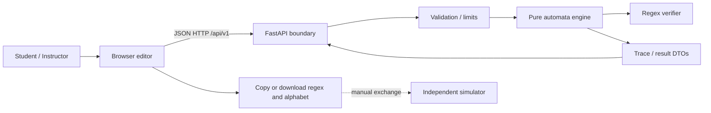
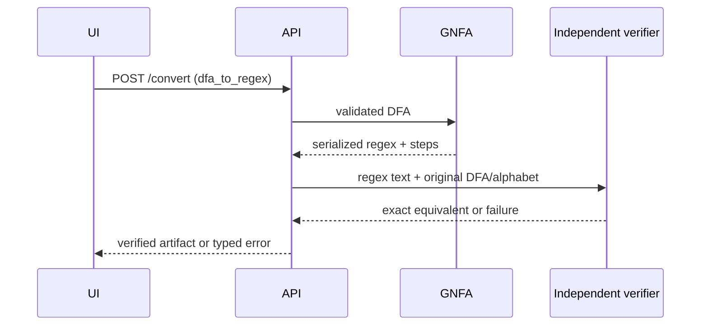

# Software Architecture & Design — Transivium

Version 0.1 | Proposed design; not implemented

## 1. Architectural goals
Keep mathematical algorithms independent of rendering, use a shared typed contract, produce reproducible traces, and verify language correctness separately from conversion. Prefer simple local deployment over infrastructure unrelated to coursework.

## 2. Proposed stack and decision register
| ADR | Decision | Rationale / status |
|---|---|---|
| ADR-01 | React + TypeScript + Vite; React Flow for diagrams | Proposed; interactive graph and typed state |
| ADR-02 | Python 3.12+ (tested version to be pinned), FastAPI, Pydantic | Proposed; readable formal algorithms and JSON validation |
| ADR-03 | Stateless HTTP API, in-memory frontend session | Proposed; no user accounts or DB needed |
| ADR-04 | Pure algorithms, no library doing coursework conversions | Proposed; transparent derivation and testability; graph/render/framework libraries permitted |
| ADR-05 | Formal regex AST and independent parser + Thompson verifier | Required outcome; design proposed |
| ADR-06 | Complete DFA, shared alphabet and canonical BFS numbering | Formal interoperability convention |
| ADR-07 | Moore initial output excluded from normalized equivalence | Formal conversion convention |
| ADR-08 | Relative six-week plan, local-only default | Proposed; deadline, team size, budget and public deployment [DECIDE] |

## 3. System context

No service-to-service call to the other team. The external simulator is outside our trust and control boundary.

## 4. Component responsibilities
| Component | Responsibility |
|---|---|
| Editor store | Mutable draft, current machine kind, layout, selection, revision counter, source/result separation |
| Graph editor | Add/edit/remove states and edges, mark initial/final/output, keyboard alternative via table/forms |
| Table and inspector | Render derived transitions; edit underlying draft; show validation issues by field |
| Simulation controller | Call run endpoint once per snapshot; play/pause/step/back/reset locally; invalidate stale trace on edits |
| Conversion workspace | Select allowed operations, display input/output and intermediate steps; explicitly adopt result as draft |
| Equivalence workspace | Build/select two machine snapshots; compare; render witness and acceptance of each machine |
| Regex export panel | Show expression, alphabet, canonical minimal DFA, verification state; copy/download only when verified |
| API router | Request schema, status mapping, limits, request ID; return serializable DTOs |
| Validator | Check formal machine model, alphabets, references, totality, input symbols |
| Acceptor engine | Closure, move, determinization, epsilon removal, minimization, equivalence, canonicalization |
| Transducer engine | Simulation and both conversions; normalized-output product checking in tests/verification |
| Regex engine | GNFA elimination, AST simplification, deterministic serializer |
| Independent verifier | Parse emitted text, Thompson construction, determinize, exact product equivalence; share tested primitives but never reuse GNFA result as proof |
| Budget guard | Cooperative deadline, state/work/trace/regex caps; typed resource error |

## 5. Proposed repository layout
```text
transivium/
  README.md
  CHANGELOG.md
  docs/                       # this documentation set
  frontend/
    src/{app,components,features,lib,types}/
    tests/
    package.json
  backend/
    app/{main.py,api,schemas,engine}/
    app/engine/{validation.py,acceptors.py,transducers.py,regex_ast.py,gnfa.py,regex_parser.py,thompson.py,budget.py}
    tests/{unit,integration,fixtures}/
    requirements.txt
```
This is a target layout, not a claim that files other than the documentation exist.

## 6. Execution and data flow
### 6.1 Editor/simulation
Draft allows incomplete states/edges. Validate locally for immediate hints and authoritatively on API. Serialize formal machine without coordinates. On simulate, backend returns initial configuration and one configuration per consumed symbol (ε closures are summarized in each step). Frontend plays immutable trace; editing increments revision; old response ignored if request revision differs.

### 6.2 Conversion
Snapshot → validate → select algorithm → result + trace → validate generated machine → show side by side. Compare acceptor source/result exactly within operation budget before successful conversion; for transducers compare normalized outputs with product search. If verification cannot complete within limits, report failure rather than certified success. Explicit adopt replaces draft; preserve source until adoption. Layout generated client-side for new states.

### 6.3 DFA-to-regex
1. Validate DFA, minimize/canonicalize to reduce expression size.
2. Add fresh GNFA start/final; label edge unions and ε links; missing edges ∅.
3. Eliminate original states deterministically; update edge ASTs and record derivation steps.
4. Simplify with language-preserving identities; serialize with explicit precedence.
5. Independently parse serialized text and Thompson-construct ε-NFA (not directly using original AST).
6. Determinize, minimize, canonicalize over original alphabet; exact product comparison with original.
7. If equivalent, return regex, alphabet, canonical source reference and verification. On error, timeout or mismatch return no verified artifact. External team independently imports plain expression and separately supplied alphabet.



## 7. State management and persistence
Frontend is source of truth for editable draft and layout. Table and diagram are projections, not duplicate models. API is stateless and stores no user machines. P0 in-memory only; refresh may lose work (explicit UI notice). P1 local JSON machine download/import and session trace history; no cloud or database. Regex JSON export P0. No user/admin accounts. P1 imported layout is optional; formal equality ignores it.

## 8. Boundaries and failure handling
Proposed limits: 256 states per formal machine, 16 input/output symbols each, 16,384 transitions, 512 input tokens, 512 KiB request, 64 KiB serialized regex (UTF-8), 50,000 regex AST nodes/work allocations, 65,536 reachable product pairs, 2,000 derivation steps and 2 MiB serialized response. Generated intermediate automata also bounded at 256 states. Simulation steps ≤ 513. Deadline 5 s per operation (cooperative monotonic checks; all loops and recursive work bounded; no claim of hard real-time interruption). Regex parsing uses explicit stack or depth guard (128 nesting levels). No partial verified result when a cap is exceeded. Ordinary reference workloads defined in PRD; evaluate limits after profiling. Limit checks must avoid allocating huge structures first. Return structured errors; frontend retains source, gives retry/reduce-size advice, discards obsolete responses. Use request IDs and avoid logging full machines/strings by default.

## 9. Security / accessibility / deployment
- Strict schema, bounded body reader, no eval, no regex execution against host engine, render labels as text, safe file parsing, no secrets required.
- Local API bind 127.0.0.1; CORS restricted to configured frontend origin; production sharing requires separate review and is not in MVP.
- Keyboard form/table editor, visible focus, accessible labels, text status, playback controls; animation is optional and respects reduced-motion preference.
- Backend unit tests plus API integration; frontend component and end-to-end tests. Pin actual dependency versions after selecting stack; no version claims here.

## 10. Risks and mitigations
| Risk | Mitigation |
|---|---|
| Subset construction / GNFA explosion | Reachable states only, simplification, bounded work, explicit limits |
| Incorrectly declaring equivalent from samples | Exact product BFS; independent regex parse and reconstruction |
| External parser conventions differ | Exchange syntax fixture suite, alphabet metadata, documented minimization convention |
| Moore initial output mismatch | Separate initial output, normalized comparison and clear UI label |
| UI/algorithm drift | Typed schemas, golden fixtures, API contracts and revision-aware state |
| Time pressure | Engine and regex correctness before visual polish and P1 |

## Memory links

- [[memory/Home]]
- [[memory/References/Documentation-Review]]
